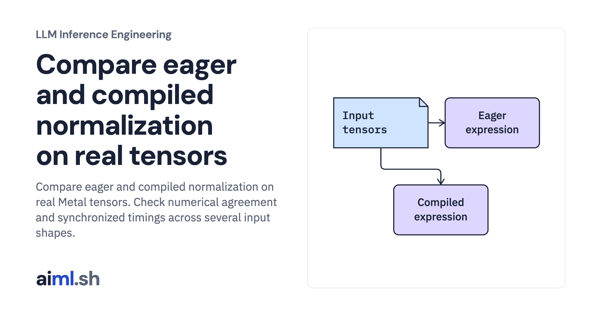

 [LLM Inference Engineering](../) · lesson 15 of 20

# Compare eager and compiled normalization on real tensors

[](https://aiml.sh/courses/llm-inference/compare-eager-and-compiled-normalization/)

Compare eager and compiled normalization on real Metal tensors. Check numerical agreement and synchronized timings across several input shapes.

- **Full lesson:** [https://aiml.sh/courses/llm-inference/compare-eager-and-compiled-normalization/](https://aiml.sh/courses/llm-inference/compare-eager-and-compiled-normalization/)
- **Reading time:** 25 min
- **Uses:** Offline checks have no external imports; live tensor execution uses mlx 0.32.4 on Metal

## Lab

The [`lab/`](lab/) folder holds the complete runnable code, tests and recorded outputs, the same files as the lesson's download on aiml.sh. The lesson explains each step.

### Lab notes

#### Compare eager and compiled normalization on real tensors

Fresh Metal eager-versus-compiled tensor experiment. CUDA/Triton execution, kernel traffic, and whole-model acceleration are unmeasured.

##### Run

Use Python 3.12 or later. From this directory:

```sh
python3 lab.py
python3 -m unittest -v test_lab.py
```

`fusion_live.py` creates actual tensors, warms both paths, checks maximum absolute output difference, and records repeated synchronized timings for several shapes, including an irregular row width. It replaces the unexecuted Triton snippet as the tested implementation.

##### Interpretation

Fusion can reduce dispatch and data movement but increase register pressure or compilation overhead. Small and large shapes can behave differently. A reduction in modeled tensor accesses is not an equal reduction in model latency; normalization may be a small fraction of the critical path.

##### Sources

- MLX compilation and fusion: https://ml-explore.github.io/mlx/build/html/usage/compile.html
- Triton normalization implementation patterns: https://triton-lang.org/main/getting-started/tutorials/05-layer-norm.html
- RMSNorm authors’ formulation: https://arxiv.org/abs/1910.07467

##### Optional fresh execution

```sh
python3 -m venv .venv
.venv/bin/python -m pip install mlx==0.32.4
.venv/bin/python fusion_live.py --output new-fusion-run.json
```

Run model commands in the pinned runtime from the first lesson. CPU and Metal results are distinct; no NVIDIA execution is claimed.
