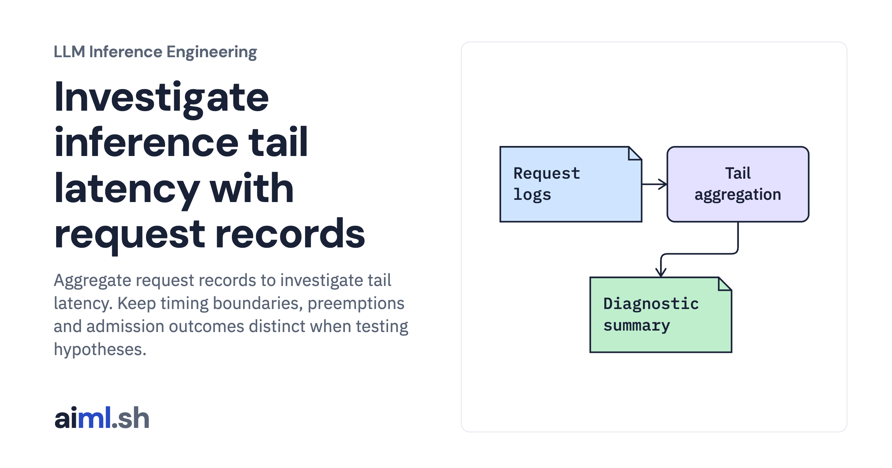

 [LLM Inference Engineering](../) · lesson 16 of 20

# Investigate inference tail latency with request records

[](https://aiml.sh/courses/llm-inference/investigate-inference-tail-latency/)

Aggregate request records to investigate tail latency. Keep timing boundaries, preemptions and admission outcomes distinct when testing hypotheses.

- **Full lesson:** [https://aiml.sh/courses/llm-inference/investigate-inference-tail-latency/](https://aiml.sh/courses/llm-inference/investigate-inference-tail-latency/)
- **Reading time:** 25 min
- **Uses:** Standard library only

## Lab

The [`lab/`](lab/) folder holds the complete runnable code, tests and recorded outputs, the same files as the lesson's download on aiml.sh. The lesson explains each step.

### Lab notes

#### Investigate inference tail latency with request records

Executable telemetry aggregation over controlled log fixtures; diagnosis labels are test hypotheses, not a recorded GPU incident.

##### Run

Use Python 3.12 or later. From this directory:

```sh
python3 lab.py
python3 -m unittest -v test_lab.py
```

`diagnose_p99_spike()` aggregates request records and returns a rule-based interpretation. The controlled windows test how outliers and queueing affect the report. The real HTTP benchmark from the earlier lesson provides a separate small request record with both successes and overloads.

##### Interpretation

A tight admission limit can lower latency among accepted requests while rejecting more users. Report offered, accepted, failed, and rejected counts together. A small sample’s maximum is not a stable estimate of production p99, and a single watermark cannot fit every model and workload.

##### Sources

- vLLM metrics design: https://docs.vllm.ai/en/latest/design/metrics/
- SGLang production metrics: https://docs.sglang.ai/references/production_metrics.html
