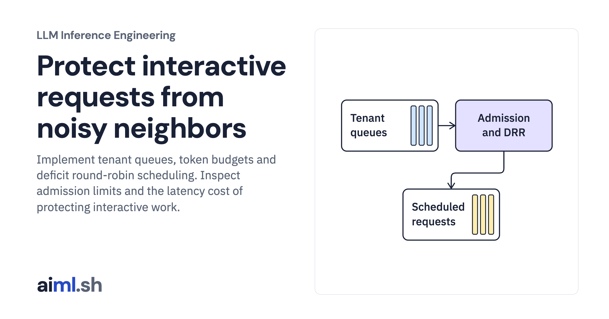

 [LLM Inference Engineering](../) · lesson 17 of 20

# Protect interactive requests from noisy neighbors

[](https://aiml.sh/courses/llm-inference/enforce-multi-tenant-fairness-priority-queues-and-admission-limits/)

Implement tenant queues, token budgets and deficit round-robin scheduling. Inspect admission limits and the latency cost of protecting interactive work.

- **Full lesson:** [https://aiml.sh/courses/llm-inference/enforce-multi-tenant-fairness-priority-queues-and-admission-limits/](https://aiml.sh/courses/llm-inference/enforce-multi-tenant-fairness-priority-queues-and-admission-limits/)
- **Reading time:** 25 min
- **Uses:** Standard library only

## Lab

The [`lab/`](lab/) folder holds the complete runnable code, tests and recorded outputs, the same files as the lesson's download on aiml.sh. The lesson explains each step.

### Lab notes

#### Protect interactive requests from noisy neighbors

Actual queue and admission-policy implementation with a deterministic service-cost model. No authentication service, multi-tenant GPU deployment, or billing system.

##### Run

Use Python 3.12 or later. From this directory:

```sh
python3 lab.py
python3 -m unittest -v test_lab.py
```

`MultiTenantScheduler` implements tenant queues, token-budget accounting, priority selection, and a cache-capacity gate. Its execution times and occupancy are modeled. The real HTTP server earlier demonstrates actual bounded admission and 429 responses; this scheduler is not wired into that model engine.

##### Interpretation

Protecting an interactive lane can reduce batch throughput or starve background work unless the policy reserves service for it. Rejecting early preserves capacity but pushes retry and backoff behavior onto clients. Estimated work should be reconciled with actual usage rather than trusted as a billable measurement.

##### Sources

- Linux fair queueing and DRR implementation: https://man7.org/linux/man-pages/man8/tc-drr.8.html
- Google Cloud inference-aware autoscaling signals: https://docs.cloud.google.com/kubernetes-engine/docs/best-practices/machine-learning/inference/autoscaling
