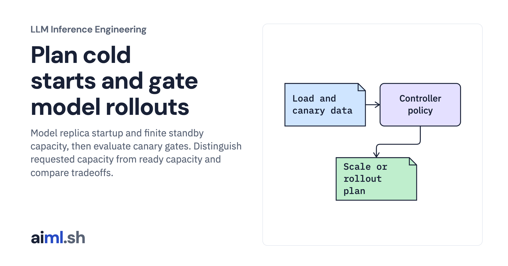

 [LLM Inference Engineering](../) · lesson 18 of 20

# Plan cold starts and gate model rollouts

[](https://aiml.sh/courses/llm-inference/autoscale-gpus-with-slow-cold-starts-and-roll-out-model-updates-safely/)

Model replica startup and finite standby capacity, then evaluate canary gates. Distinguish requested capacity from ready capacity and compare tradeoffs.

- **Full lesson:** [https://aiml.sh/courses/llm-inference/autoscale-gpus-with-slow-cold-starts-and-roll-out-model-updates-safely/](https://aiml.sh/courses/llm-inference/autoscale-gpus-with-slow-cold-starts-and-roll-out-model-updates-safely/)
- **Reading time:** 25 min
- **Uses:** Standard library only

## Lab

The [`lab/`](lab/) folder holds the complete runnable code, tests and recorded outputs, the same files as the lesson's download on aiml.sh. The lesson explains each step.

### Lab notes

#### Plan cold starts and gate model rollouts

Executable controller policy and startup simulation. Replica starts, real traffic routing, canary quality evaluation, and rollback deployment were not executed.

##### Run

Use Python 3.12 or later. From this directory:

```sh
python3 lab.py
python3 -m unittest -v test_lab.py
```

`simulate_autoscaler()` tracks booting and ready replicas on a controlled traffic timeline. `CanaryGate` evaluates supplied latency, error, and quality samples and stops its sequence after a rejected stage. These quality samples are fixtures, not scored model outputs.

##### Interpretation

Warm capacity costs money while idle; waiting for demand can miss the latency target during startup. Faster startup and better steady-state performance may require different compilation choices. A canary with too few or unrepresentative requests can miss regressions even when its gates pass.

##### Sources

- Ray Serve autoscaling controls: https://docs.ray.io/en/latest/serve/advanced-guides/advanced-autoscaling.html
- Kubernetes HPA behavior: https://kubernetes.io/docs/concepts/workloads/autoscaling/horizontal-pod-autoscale/
- GKE inference autoscaling tradeoffs: https://docs.cloud.google.com/kubernetes-engine/docs/best-practices/machine-learning/inference/autoscaling
