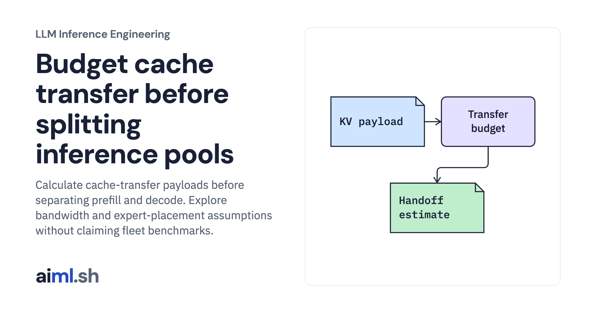

 [LLM Inference Engineering](../) · lesson 19 of 20

# Budget cache transfer before splitting inference pools

[](https://aiml.sh/courses/llm-inference/split-prefill-and-decode-pools-and-serve-large-moe-models/)

Calculate cache-transfer payloads before separating prefill and decode. Explore bandwidth and expert-placement assumptions without claiming fleet benchmarks.

- **Full lesson:** [https://aiml.sh/courses/llm-inference/split-prefill-and-decode-pools-and-serve-large-moe-models/](https://aiml.sh/courses/llm-inference/split-prefill-and-decode-pools-and-serve-large-moe-models/)
- **Reading time:** 25 min
- **Uses:** Standard library only

## Lab

The [`lab/`](lab/) folder holds the complete runnable code, tests and recorded outputs, the same files as the lesson's download on aiml.sh. The lesson explains each step.

### Lab notes

#### Budget cache transfer before splitting inference pools

Payload calculator and explicit disaggregation/MoE cost scenarios. No networked KV transfer, multi-GPU model execution, or throughput improvement was measured.

##### Run

Use Python 3.12 or later. From this directory:

```sh
python3 lab.py
python3 -m unittest -v test_lab.py
```

`ModelKVSpec` calculates transfer payload, and `evaluate_pd_disaggregation()` exposes bandwidth and overlap assumptions. The MoE calculation is a separate scenario model, not a DeepSeek deployment. The code does not move tensors between real GPUs or validate a KV connector.

##### Interpretation

Separating pools can help control phase-specific latency, but adds network work, routing, failure recovery, and capacity coordination. It is not a general throughput improvement. Overlap may hide only part of transfer time. MoE expert placement and replication add another independent tradeoff.

##### Sources

- vLLM disaggregated prefill boundaries: https://docs.vllm.ai/en/latest/features/disagg_prefill/
- SGLang prefill/decode disaggregation: https://docs.sglang.ai/advanced_features/pd_disaggregation.html
- vLLM expert parallel deployment: https://docs.vllm.ai/en/latest/serving/expert_parallel_deployment/
