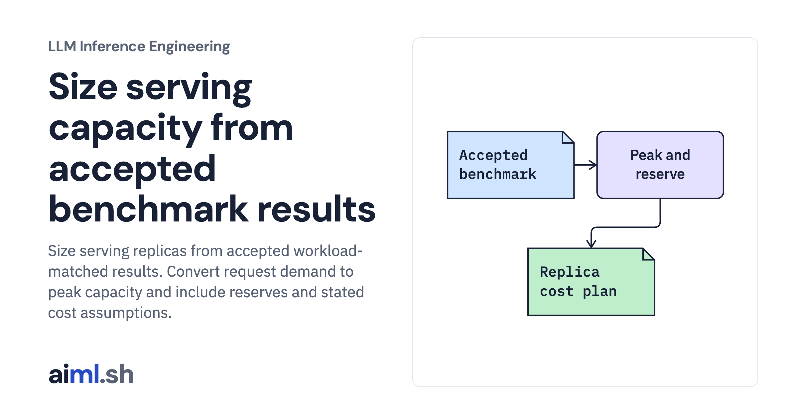

 [LLM Inference Engineering](../) · lesson 20 of 20

# Size serving capacity from accepted benchmark results

[](https://aiml.sh/courses/llm-inference/size-serving-capacity/)

Size serving replicas from accepted workload-matched results. Convert request demand to peak capacity and include reserves and stated cost assumptions.

- **Full lesson:** [https://aiml.sh/courses/llm-inference/size-serving-capacity/](https://aiml.sh/courses/llm-inference/size-serving-capacity/)
- **Reading time:** 25 min
- **Uses:** Standard library only

## Lab

The [`lab/`](lab/) folder holds the complete runnable code, tests and recorded outputs, the same files as the lesson's download on aiml.sh. The lesson explains each step.

### Lab notes

#### Size serving capacity from accepted benchmark results

Real capacity-planning code with labeled test inputs. No production fleet, quality pass, market price, or percentage savings is claimed.

##### Run

Use Python 3.12 or later. From this directory:

```sh
python3 lab.py
python3 -m unittest -v test_lab.py
```

`CapacityEvidence` separates measured input from the forecast. `plan()` rejects missing or unaccepted evidence and includes reserve replicas in hourly cost. The default output uses clearly labeled unit-test inputs so its arithmetic is reproducible; it is not a million-user fleet estimate.

##### Interpretation

Extra reserve protects capacity when a replica is unavailable but increases idle cost. A peak-sized fleet may waste off-peak capacity, while aggressive scaling can miss bursts during cold starts. Optimization effects interact, so multiplying advertised savings percentages is not a valid cost model.

##### Sources

- AWS load-testing-based capacity planning: https://docs.aws.amazon.com/sagemaker/latest/dg/endpoint-scaling-loadtest.html
- Microsoft serving-endpoint load tests: https://learn.microsoft.com/en-us/azure/databricks/machine-learning/model-serving/what-is-load-test
