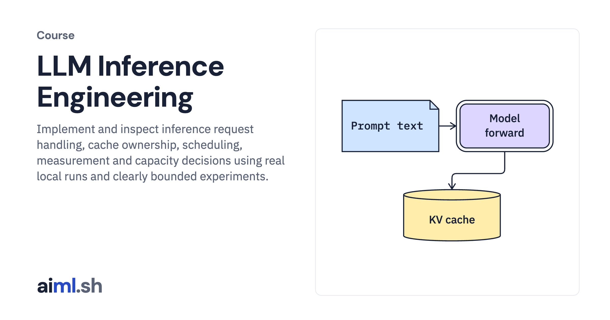

#  LLM Inference Engineering

Implement and inspect inference request handling, cache ownership, scheduling, measurement and capacity decisions using real local runs and clearly bounded experiments.

- **Course on aiml.sh:** [https://aiml.sh/courses/llm-inference/](https://aiml.sh/courses/llm-inference/)
- **Lessons:** 20 · **Reading time:** about 8 hours
- **Prerequisites:** Python functions, dataclasses, HTTP and JSON; basic causal attention. Offline labs run without a GPU. Live text experiments require the pinned model and runtime; Metal and CPU commands are identified separately.

## What you'll learn

- Measure actual prefill, decode, streaming and cancellation behavior with a pinned open model.
- Implement cache allocation and request scheduling, then reason about memory, queueing and latency.
- Evaluate a quantized candidate, profile host work and compare compiled normalization on real tensors.
- Separate workload measurements from assumed cost models when comparing operating points, admission policies, rollout gates and capacity plans.

## Lessons

| # | Lesson | Time | Code | Full lesson |
|---|---|---|---|---|
| 1 | [Trace a real inference request from prompt to first token](01-trace-an-inference-request/) | 25&nbsp;min | [lab](01-trace-an-inference-request/lab/) | [read](https://aiml.sh/courses/llm-inference/trace-an-inference-request/) |
| 2 | [Stream model output and stop work when the client disconnects](02-stream-tokens-over-sse-and-cancel-dropped-requests/) | 25&nbsp;min | [lab](02-stream-tokens-over-sse-and-cancel-dropped-requests/lab/) | [read](https://aiml.sh/courses/llm-inference/stream-tokens-over-sse-and-cancel-dropped-requests/) |
| 3 | [Benchmark streaming inference under load](03-benchmark-streaming-inference/) | 25&nbsp;min | [lab](03-benchmark-streaming-inference/lab/) | [read](https://aiml.sh/courses/llm-inference/benchmark-streaming-inference/) |
| 4 | [Budget model weights, KV cache, and runtime memory](04-size-gpu-memory-for-model-weights-and-the-kv-cache/) | 25&nbsp;min | [lab](04-size-gpu-memory-for-model-weights-and-the-kv-cache/lab/) | [read](https://aiml.sh/courses/llm-inference/size-gpu-memory-for-model-weights-and-the-kv-cache/) |
| 5 | [Choose hardware from the workload bottleneck](05-choose-hardware-for-inference/) | 25&nbsp;min | [lab](05-choose-hardware-for-inference/lab/) | [read](https://aiml.sh/courses/llm-inference/choose-hardware-for-inference/) |
| 6 | [Implement paged cache allocation and copy-on-write](06-stop-memory-waste-with-paged-kv-caching/) | 25&nbsp;min | [lab](06-stop-memory-waste-with-paged-kv-caching/lab/) | [read](https://aiml.sh/courses/llm-inference/stop-memory-waste-with-paged-kv-caching/) |
| 7 | [Explain tiled attention and verify its output](07-verify-tiled-attention/) | 25&nbsp;min | [lab](07-verify-tiled-attention/lab/) | [read](https://aiml.sh/courses/llm-inference/verify-tiled-attention/) |
| 8 | [Schedule requests between decode iterations](08-replace-static-batching-with-continuous-batching/) | 25&nbsp;min | [lab](08-replace-static-batching-with-continuous-batching/lab/) | [read](https://aiml.sh/courses/llm-inference/replace-static-batching-with-continuous-batching/) |
| 9 | [Balance long-prompt prefill against streaming latency](09-fix-long-prompt-stalls-with-chunked-prefill/) | 25&nbsp;min | [lab](09-fix-long-prompt-stalls-with-chunked-prefill/lab/) | [read](https://aiml.sh/courses/llm-inference/fix-long-prompt-stalls-with-chunked-prefill/) |
| 10 | [Reuse prompt prefixes without overloading a warm replica](10-cache-shared-prompt-prefixes-and-route-to-warm-gpus/) | 25&nbsp;min | [lab](10-cache-shared-prompt-prefixes-and-route-to-warm-gpus/lab/) | [read](https://aiml.sh/courses/llm-inference/cache-shared-prompt-prefixes-and-route-to-warm-gpus/) |
| 11 | [Quantize a model and evaluate the regression](11-evaluate-model-quantization/) | 25&nbsp;min | [lab](11-evaluate-model-quantization/lab/) | [read](https://aiml.sh/courses/llm-inference/evaluate-model-quantization/) |
| 12 | [Check speculative decoding correctness and its cost](12-use-speculative-decoding-and-know-when-it-hurts/) | 25&nbsp;min | [lab](12-use-speculative-decoding-and-know-when-it-hurts/lab/) | [read](https://aiml.sh/courses/llm-inference/use-speculative-decoding-and-know-when-it-hurts/) |
| 13 | [Choose a latency-throughput operating point](13-choose-a-latency-throughput-operating-point/) | 25&nbsp;min | [lab](13-choose-a-latency-throughput-operating-point/lab/) | [read](https://aiml.sh/courses/llm-inference/choose-a-latency-throughput-operating-point/) |
| 14 | [Investigate host overhead before changing GPU settings](14-profile-inference-host-overhead/) | 25&nbsp;min | [lab](14-profile-inference-host-overhead/lab/) | [read](https://aiml.sh/courses/llm-inference/profile-inference-host-overhead/) |
| 15 | [Compare eager and compiled normalization on real tensors](15-compare-eager-and-compiled-normalization/) | 25&nbsp;min | [lab](15-compare-eager-and-compiled-normalization/lab/) | [read](https://aiml.sh/courses/llm-inference/compare-eager-and-compiled-normalization/) |
| 16 | [Investigate inference tail latency with request records](16-investigate-inference-tail-latency/) | 25&nbsp;min | [lab](16-investigate-inference-tail-latency/lab/) | [read](https://aiml.sh/courses/llm-inference/investigate-inference-tail-latency/) |
| 17 | [Protect interactive requests from noisy neighbors](17-enforce-multi-tenant-fairness-priority-queues-and-admission-limits/) | 25&nbsp;min | [lab](17-enforce-multi-tenant-fairness-priority-queues-and-admission-limits/lab/) | [read](https://aiml.sh/courses/llm-inference/enforce-multi-tenant-fairness-priority-queues-and-admission-limits/) |
| 18 | [Plan cold starts and gate model rollouts](18-autoscale-gpus-with-slow-cold-starts-and-roll-out-model-updates-safely/) | 25&nbsp;min | [lab](18-autoscale-gpus-with-slow-cold-starts-and-roll-out-model-updates-safely/lab/) | [read](https://aiml.sh/courses/llm-inference/autoscale-gpus-with-slow-cold-starts-and-roll-out-model-updates-safely/) |
| 19 | [Budget cache transfer before splitting inference pools](19-split-prefill-and-decode-pools-and-serve-large-moe-models/) | 25&nbsp;min | [lab](19-split-prefill-and-decode-pools-and-serve-large-moe-models/lab/) | [read](https://aiml.sh/courses/llm-inference/split-prefill-and-decode-pools-and-serve-large-moe-models/) |
| 20 | [Size serving capacity from accepted benchmark results](20-size-serving-capacity/) | 25&nbsp;min | [lab](20-size-serving-capacity/lab/) | [read](https://aiml.sh/courses/llm-inference/size-serving-capacity/) |

Each lesson folder has a short summary, its diagram and its lab. The complete lesson, with explanations, recorded results and checks, is on aiml.sh.

[Back to all courses](../../README.md#courses)
