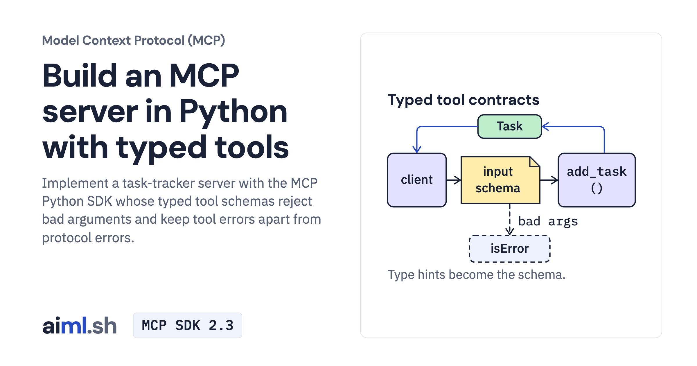

 [Model Context Protocol (MCP)](../) · lesson 1 of 7

# Implement an MCP server with typed tool contracts

[](https://aiml.sh/courses/mcp/implement-an-mcp-server-with-typed-tool-contracts/)

Implement a task-tracker server with the MCP Python SDK whose typed tool schemas reject bad arguments and keep tool errors apart from protocol errors.

- **Full lesson:** [https://aiml.sh/courses/mcp/implement-an-mcp-server-with-typed-tool-contracts/](https://aiml.sh/courses/mcp/implement-an-mcp-server-with-typed-tool-contracts/)
- **Reading time:** 15 min
- **Uses:** mcp 2.3.0, the official MCP Python SDK, with Pydantic 2.14.1

## Lab

The [`lab/`](lab/) folder holds the complete runnable code, tests and recorded outputs, the same files as the lesson's download on aiml.sh. The lesson explains each step.

### Lab notes

#### Implement an MCP server with typed tool contracts

Download `/labs/implement-an-mcp-server-with-typed-tool-contracts.zip`, extract it, and open `mcp-typed-tools/`. Keep all included source, fixtures, locks and tests together. Requires Python 3.12 or later.

##### Setup and execution

The local tests use the real SDK and server. They do not call a hosted model.

From this lab directory, follow the commands in order. Separate terminal comments mark servers that must keep running. Read each script before invoking it. Recording drivers can replace the bundled result files, so use a fresh extracted copy for new runs.

```sh
python3.12 -m venv .venv
.venv/bin/python -m pip install -r requirements-lock.txt
```

```sh
.venv/bin/python client.py
```

```sh
.venv/bin/python -m unittest -v test_tasks_server.py
```

Saved output files describe the original runs. Passing the offline/local tests checks the stated contracts; it does not establish model quality or production security.
