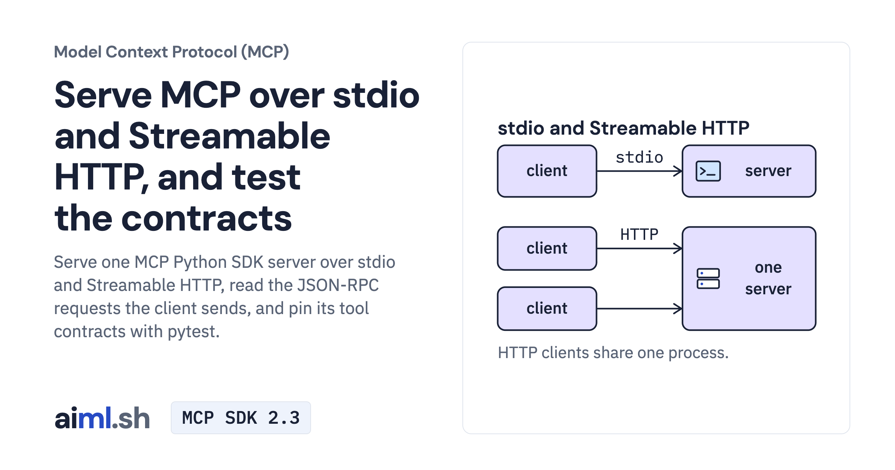

 [Model Context Protocol (MCP)](../) · lesson 2 of 7

# Serve MCP over stdio and Streamable HTTP, and test the contracts

[](https://aiml.sh/courses/mcp/serve-mcp-over-stdio-and-streamable-http-and-test-the-contracts/)

Serve one MCP Python SDK server over stdio and Streamable HTTP, read the JSON-RPC requests the client sends, and pin its tool contracts with pytest.

- **Full lesson:** [https://aiml.sh/courses/mcp/serve-mcp-over-stdio-and-streamable-http-and-test-the-contracts/](https://aiml.sh/courses/mcp/serve-mcp-over-stdio-and-streamable-http-and-test-the-contracts/)
- **Reading time:** 20 min
- **Uses:** mcp 2.3.0, the official MCP Python SDK, with pytest 9.1.1

## Lab

The [`lab/`](lab/) folder holds the complete runnable code, tests and recorded outputs, the same files as the lesson's download on aiml.sh. The lesson explains each step.

### Lab notes

#### Serve MCP over stdio and Streamable HTTP, and test the contracts

Download `/labs/serve-mcp-over-stdio-and-streamable-http-and-test-the-contracts.zip`, extract it, and open `mcp-transports/`. Keep all included source, fixtures, locks and tests together. Requires Python 3.12 or later.

##### Setup and execution

Extract the typed-tools ZIP beside this lab: a regression compares both server files. Tests use real local stdio/HTTP processes and no model.

From this lab directory, follow the commands in order. Separate terminal comments mark servers that must keep running. Read each script before invoking it. Recording drivers can replace the bundled result files, so use a fresh extracted copy for new runs.

```sh
python3.12 -m venv .venv
.venv/bin/python -m pip install -r requirements-lock.txt
```

```sh
.venv/bin/python serve.py --http --port 8000

#### in a second terminal
.venv/bin/python client.py stdio
.venv/bin/python client.py http://127.0.0.1:8000/mcp
.venv/bin/python client.py http://127.0.0.1:8000/mcp
```

```sh
.venv/bin/python -m pytest -v
```

Saved output files describe the original runs. Passing the offline/local tests checks the stated contracts; it does not establish model quality or production security.
