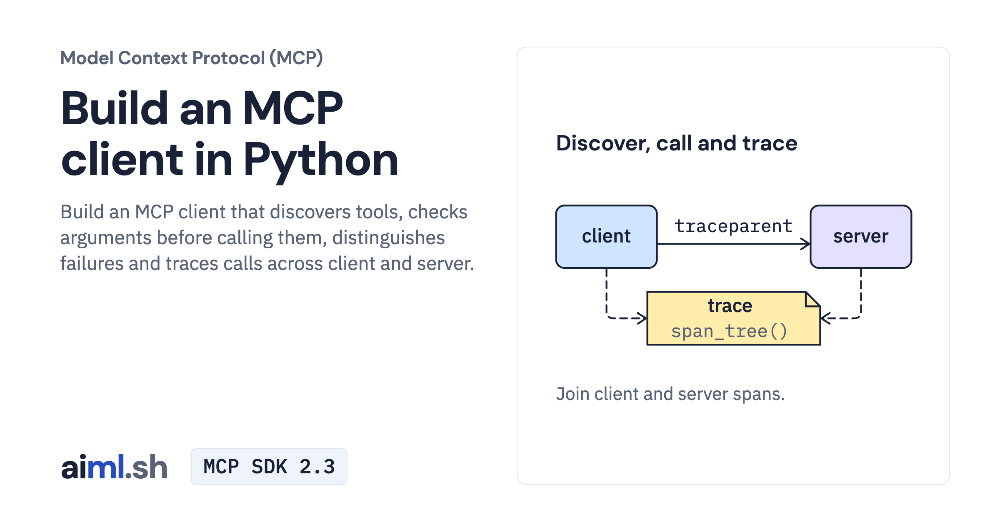

 [Model Context Protocol (MCP)](../) · lesson 3 of 7

# Build an MCP client with discovery, calls and tracing

[](https://aiml.sh/courses/mcp/build-an-mcp-client/)

Build an MCP client that discovers tools, checks arguments before calling them, distinguishes failures and traces calls across client and server.

- **Full lesson:** [https://aiml.sh/courses/mcp/build-an-mcp-client/](https://aiml.sh/courses/mcp/build-an-mcp-client/)
- **Reading time:** 22 min
- **Uses:** mcp 2.3.0, the official MCP Python SDK; opentelemetry-sdk 1.45.1; jsonschema, installed with the SDK

## Lab

The [`lab/`](lab/) folder holds the complete runnable code, tests and recorded outputs, the same files as the lesson's download on aiml.sh. The lesson explains each step.

### Lab notes

#### Build an MCP client with discovery, calls and tracing

Download `/labs/build-an-mcp-client.zip`, extract it, and open `mcp-client-tracing/`. Keep all included source, fixtures, locks and tests together. Requires Python 3.12 or later.

##### Setup and execution

The local tests use the real SDK and server. They do not call a hosted model.

From this lab directory, follow the commands in order. Separate terminal comments mark servers that must keep running. Read each script before invoking it. Recording drivers can replace the bundled result files, so use a fresh extracted copy for new runs.

```sh
python3.12 -m venv .venv
.venv/bin/python -m pip install -r requirements-lock.txt
```

```sh
.venv/bin/python traced_client.py --write-log execution-log.json --write-trace trace-tree.json
```

```sh
.venv/bin/python -m unittest -v test_traced_client.py
```

Saved output files describe the original runs. Passing the offline/local tests checks the stated contracts; it does not establish model quality or production security.
