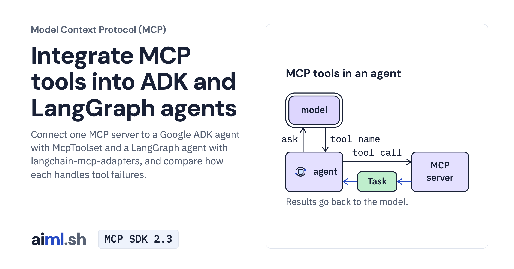

 [Model Context Protocol (MCP)](../) · lesson 5 of 7

# Integrate MCP tools into ADK and LangGraph agents

[](https://aiml.sh/courses/mcp/integrate-mcp-tools-into-adk-and-langgraph-agents/)

Connect one MCP server to a Google ADK agent with McpToolset and a LangGraph agent with langchain-mcp-adapters, and compare how each handles tool failures.

- **Full lesson:** [https://aiml.sh/courses/mcp/integrate-mcp-tools-into-adk-and-langgraph-agents/](https://aiml.sh/courses/mcp/integrate-mcp-tools-into-adk-and-langgraph-agents/)
- **Reading time:** 20 min
- **Uses:** google-adk 2.12.0 with litellm 1.102.4; langchain 1.4.6, langgraph 1.2.16, langchain-mcp-adapters 0.3.2 and langchain-ollama 1.1.0; mcp 1.30.0 in the agent environment and mcp 2.3.0 for the server

## Lab

The [`lab/`](lab/) folder holds the complete runnable code, tests and recorded outputs, the same files as the lesson's download on aiml.sh. The lesson explains each step.

### Lab notes

#### Integrate MCP tools into ADK and LangGraph agents

Download `/labs/integrate-mcp-tools-into-adk-and-langgraph-agents.zip`, extract it, and open `mcp-agent-frameworks/`. Keep all included source, fixtures, locks and tests together. Requires Python 3.12 or later.

##### Setup and execution

Extract the typed-tools ZIP beside this lab; its server source is compared by the tests. Keep its MCP 2.3 environment separate from the framework adapters. Tests replay saved model replies through the real adapters and MCP server. Live agent commands contact Ollama and require the model; they do not replay recordings.

From this lab directory, follow the commands in order. Separate terminal comments mark servers that must keep running. Read each script before invoking it. Recording drivers can replace the bundled result files, so use a fresh extracted copy for new runs.

```sh
#### Extract the typed-tools lab alongside this folder before continuing.
python3.12 -m venv ../mcp-typed-tools/.venv
../mcp-typed-tools/.venv/bin/python -m pip install -r ../mcp-typed-tools/requirements-lock.txt
python3.12 -m venv .venv-agents
.venv-agents/bin/python -m pip install -r requirements-lock.txt
export TASKS_SERVER_PYTHON="$(cd ../mcp-typed-tools && pwd)/.venv/bin/python"
export OLLAMA_API_BASE=http://localhost:11434
```

```sh
.venv-agents/bin/python agent_adk.py "Close the docs task."
.venv-agents/bin/python agent_langgraph.py "Close the docs task."
.venv-agents/bin/python agent_adk.py "Mark task T-9 as done."
.venv-agents/bin/python agent_langgraph.py "Mark task T-9 as done."
```

Saved output files describe the original runs. Passing the offline/local tests checks the stated contracts; it does not establish model quality or production security.

Test the adapters with recorded model turns after exporting `TASKS_SERVER_PYTHON`:

```sh
.venv-agents/bin/python -W ignore -m unittest -v test_agents.py
```
