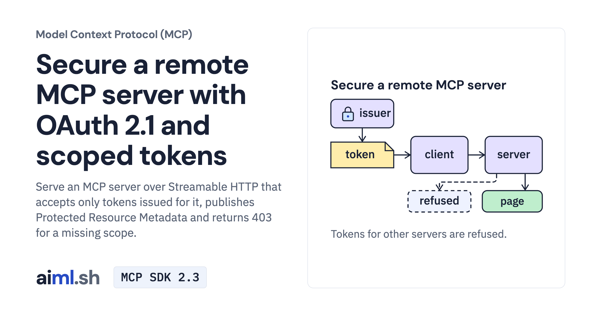

 [Model Context Protocol (MCP)](../) · lesson 6 of 7

# Secure a remote MCP server with OAuth 2.1 and scoped tokens

[](https://aiml.sh/courses/mcp/build-a-remote-mcp-service-with-authentication-and-authorization/)

Serve an MCP server over Streamable HTTP that accepts only tokens issued for it, publishes Protected Resource Metadata and returns 403 for a missing scope.

- **Full lesson:** [https://aiml.sh/courses/mcp/build-a-remote-mcp-service-with-authentication-and-authorization/](https://aiml.sh/courses/mcp/build-a-remote-mcp-service-with-authentication-and-authorization/)
- **Reading time:** 24 min
- **Uses:** mcp 2.3.0, the official MCP Python SDK, with the Starlette, uvicorn, httpx2 and PyJWT packages it installs

## Lab

The [`lab/`](lab/) folder holds the complete runnable code, tests and recorded outputs, the same files as the lesson's download on aiml.sh. The lesson explains each step.

### Lab notes

#### Secure a remote MCP server with OAuth 2.1 and scoped tokens

Download `/labs/build-a-remote-mcp-service-with-authentication-and-authorization.zip`, extract it, and open `mcp-remote-auth/`. Keep all included source, fixtures, locks and tests together. Requires Python 3.12 or later.

##### Setup and execution

The local tests use the real SDK and server. They do not call a hosted model.

From this lab directory, follow the commands in order. Separate terminal comments mark servers that must keep running. Read each script before invoking it. Recording drivers can replace the bundled result files, so use a fresh extracted copy for new runs.

```sh
python3.12 -m venv .venv
.venv/bin/python -m pip install -r requirements-lock.txt
```

```sh
.venv/bin/python record_flows.py --write auth-flows.json
```

```sh
.venv/bin/python -m unittest -v test_remote_auth.py
```

Saved output files describe the original runs. Passing the offline/local tests checks the stated contracts; it does not establish model quality or production security.
