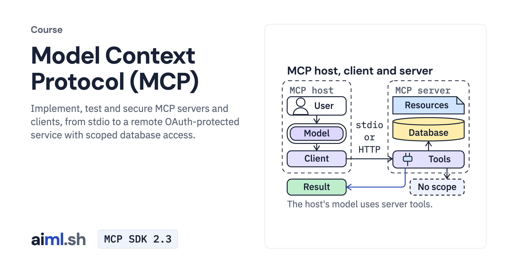

#  Model Context Protocol (MCP)

Implement, test and secure MCP servers and clients, from stdio to a remote OAuth-protected service with scoped database access.

- **Course on aiml.sh:** [https://aiml.sh/courses/mcp/](https://aiml.sh/courses/mcp/)
- **Lessons:** 7 · **Reading time:** about 2 hours
- **Prerequisites:** Python 3.12 and async Python, and basic HTTP and SQL.
- **Framework:** MCP SDK 2.3

## What you'll learn

- Implement typed MCP tools, serve them over stdio and Streamable HTTP, and pin their contracts in tests.
- Build an MCP client that acts on discovery, checks each call before sending it and traces it across processes.
- Expose resources, resource templates and prompts from an MCP server, and test each primitive.
- Give MCP tools to Google ADK and LangGraph agents running Gemma, and handle a failing tool.
- Secure a remote MCP server with OAuth 2.1 and scoped tokens, and serve a read-only database with scoped roles and row caps.

## Lessons

| # | Lesson | Time | Code | Full lesson |
|---|---|---|---|---|
| 1 | [Implement an MCP server with typed tool contracts](01-implement-an-mcp-server-with-typed-tool-contracts/) | 15&nbsp;min | [lab](01-implement-an-mcp-server-with-typed-tool-contracts/lab/) | [read](https://aiml.sh/courses/mcp/implement-an-mcp-server-with-typed-tool-contracts/) |
| 2 | [Serve MCP over stdio and Streamable HTTP, and test the contracts](02-serve-mcp-over-stdio-and-streamable-http-and-test-the-contracts/) | 20&nbsp;min | [lab](02-serve-mcp-over-stdio-and-streamable-http-and-test-the-contracts/lab/) | [read](https://aiml.sh/courses/mcp/serve-mcp-over-stdio-and-streamable-http-and-test-the-contracts/) |
| 3 | [Build an MCP client with discovery, calls and tracing](03-build-an-mcp-client/) | 22&nbsp;min | [lab](03-build-an-mcp-client/lab/) | [read](https://aiml.sh/courses/mcp/build-an-mcp-client/) |
| 4 | [Expose resources and prompts from an MCP server](04-build-an-mcp-server-with-tools-resources-and-prompts/) | 20&nbsp;min | [lab](04-build-an-mcp-server-with-tools-resources-and-prompts/lab/) | [read](https://aiml.sh/courses/mcp/build-an-mcp-server-with-tools-resources-and-prompts/) |
| 5 | [Integrate MCP tools into ADK and LangGraph agents](05-integrate-mcp-tools-into-adk-and-langgraph-agents/) | 20&nbsp;min | [lab](05-integrate-mcp-tools-into-adk-and-langgraph-agents/lab/) | [read](https://aiml.sh/courses/mcp/integrate-mcp-tools-into-adk-and-langgraph-agents/) |
| 6 | [Secure a remote MCP server with OAuth 2.1 and scoped tokens](06-build-a-remote-mcp-service-with-authentication-and-authorization/) | 24&nbsp;min | [lab](06-build-a-remote-mcp-service-with-authentication-and-authorization/lab/) | [read](https://aiml.sh/courses/mcp/build-a-remote-mcp-service-with-authentication-and-authorization/) |
| 7 | [Build a read-only database MCP server with scoped roles](07-build-a-scoped-postgresql-mcp-tool-with-read-only-roles-and-query-limits/) | 26&nbsp;min | [lab](07-build-a-scoped-postgresql-mcp-tool-with-read-only-roles-and-query-limits/lab/) | [read](https://aiml.sh/courses/mcp/build-a-scoped-postgresql-mcp-tool-with-read-only-roles-and-query-limits/) |

Each lesson folder has a short summary, its diagram and its lab. The complete lesson, with explanations, recorded results and checks, is on aiml.sh.

[Back to all courses](../../README.md#courses)
