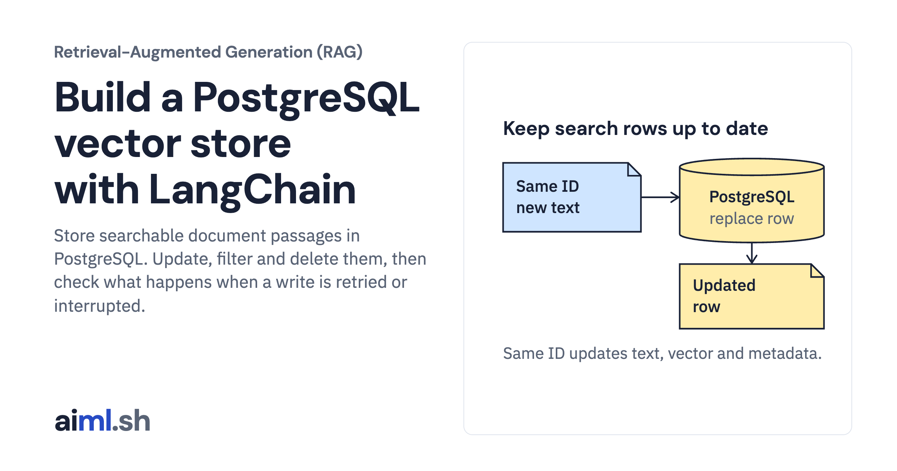

 [Retrieval-Augmented Generation (RAG)](../) · lesson 2 of 6

# Build a PostgreSQL vector store with LangChain

[](https://aiml.sh/courses/rag/build-a-vector-store/)

Store searchable document passages in PostgreSQL. Update, filter and delete them, then check what happens when a write is retried or interrupted.

- **Full lesson:** [https://aiml.sh/courses/rag/build-a-vector-store/](https://aiml.sh/courses/rag/build-a-vector-store/)
- **Reading time:** 24 min
- **Uses:** LangChain PostgreSQL, Ollama and Gemini integrations; NumPy; Pillow (locked versions in the download)

## Lab

The [`lab/`](lab/) folder holds the complete runnable code, tests and recorded outputs, the same files as the lesson's download on aiml.sh. The lesson explains each step.

### Lab notes

#### Build a PostgreSQL vector store with LangChain

A self-contained lab using fictional internal developer documentation. The current implementation lives at the lab root. Earlier implementation files are isolated in `legacy/` for historical reference.

##### Install

Use Python 3.12 or later. Install PostgreSQL 17 with its pgvector extension, and set `PG_BIN` to the server binary directory if it differs from the helper's default. The helper creates a temporary localhost-only cluster on an unused port other than 5432 and stops and deletes it on exit. Its temporary trusted role is for this local exercise, not a production authentication configuration.

```sh
python3 -m venv .venv
.venv/bin/pip install -r library-requirements-lock.txt
.venv/bin/python -m unittest -v test_library
.venv/bin/python library_store.py
```

To create new embeddings, run Ollama with `qwen3-embedding:0.6b` already installed. Gemini generation uses `gemini-3.8-flash` through the Developer API; configure `GOOGLE_API_KEY` or `GEMINI_API_KEY` outside these files. Never include keys in output. Store/index/cosine tests replay saved real vectors and need no API key. Image tests use retained PNG files and Pillow.

`langchain-postgres==0.0.19` requires `pgvector<0.4`; the lock deliberately uses compatible Python package 0.3.6 rather than the incompatible newer 0.5.1. The PostgreSQL extension and Python package have separate versions. The code uses current `PGEngine`/`PGVectorStore`, not deprecated `PGVector`.

Recorded output is one run with the versions and settings it names. Chart numbers are supplied illustration values, not timings of this pipeline. Citation ID and excerpt checks do not grade whether an answer follows from its source.

When running the repository-wide registered suites, set `AIML_RAG_PYTHON` to this lab environment's Python executable. The standalone commands above do not need that variable.

##### Current lesson files

- Entry point: `library_store.py`.
- Shared adapters: `library.py`; database helper: `pg_cluster.py` where used.
- Dependency lock: `library-requirements-lock.txt`.
- Offline suite: `python -m unittest -v test_library`.
- `legacy/` contains the earlier implementation, separate from these entry points.
