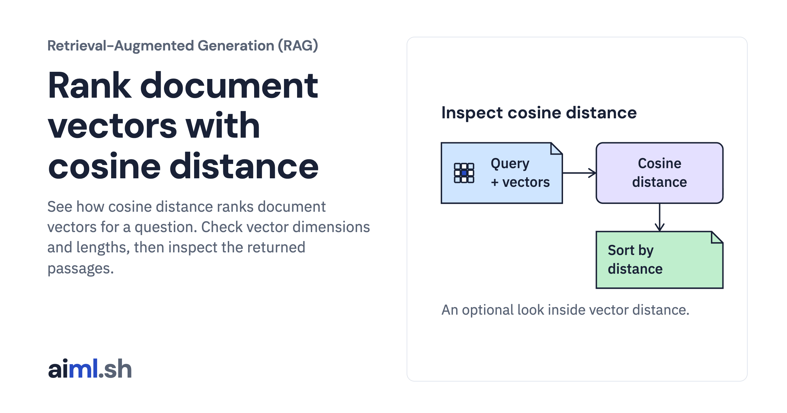

 [Retrieval-Augmented Generation (RAG)](../) · lesson 6 of 6

# Rank document vectors with cosine distance

[](https://aiml.sh/courses/rag/build-exact-vector-search/)

See how cosine distance ranks document vectors for a question. Check vector dimensions and lengths, then inspect the returned passages.

- **Full lesson:** [https://aiml.sh/courses/rag/build-exact-vector-search/](https://aiml.sh/courses/rag/build-exact-vector-search/)
- **Reading time:** 16 min
- **Uses:** NumPy and the locked LangChain adapters imported by library.py; no running PostgreSQL, Ollama or Gemini service needed

## Lab

The [`lab/`](lab/) folder holds the complete runnable code, tests and recorded outputs, the same files as the lesson's download on aiml.sh. The lesson explains each step.

### Lab notes

#### Inspect cosine distance under the hood

A self-contained lab using fictional internal developer documentation. The current implementation lives at the lab root. Earlier implementation files are isolated in `legacy/` for historical reference.

##### Install

Use Python 3.12 or later and install the lock below. The saved-vector calculation and its tests need no running PostgreSQL, Ollama or Gemini service and no API key. `library_exact.py` imports `documents()` from `library.py`, so install its LangChain adapters as well as NumPy even though this activity makes no service requests.

```sh
python3 -m venv .venv
.venv/bin/pip install -r library-requirements-lock.txt
.venv/bin/python -m unittest -v test_library_exact
.venv/bin/python library_exact.py
```

To create new embeddings, run Ollama with `qwen3-embedding:0.6b` already installed. Gemini generation uses `gemini-3.8-flash` through the Developer API; configure `GOOGLE_API_KEY` or `GEMINI_API_KEY` outside these files. Never include keys in output. Store/index/cosine tests replay saved real vectors and need no API key. Image tests use retained PNG files and Pillow.

`langchain-postgres==0.0.19` requires `pgvector<0.4`; the lock deliberately uses compatible Python package 0.3.6 rather than the incompatible newer 0.5.1. The PostgreSQL extension and Python package have separate versions. The code uses current `PGEngine`/`PGVectorStore`, not deprecated `PGVector`.

Recorded output is one run with the versions and settings it names. Chart numbers are supplied illustration values, not timings of this pipeline. Citation ID and excerpt checks do not grade whether an answer follows from its source.

When running the repository-wide registered suites, set `AIML_RAG_PYTHON` to this lab environment's Python executable. The standalone commands above do not need that variable.

##### Current lesson files

- Entry point: `library_exact.py`.
- Shared adapters: `library.py`; database helper: `pg_cluster.py` where used.
- Dependency lock: `library-requirements-lock.txt`.
- Offline suite: `python -m unittest -v test_library_exact`.
- `legacy/` contains the earlier implementation, separate from these entry points.
