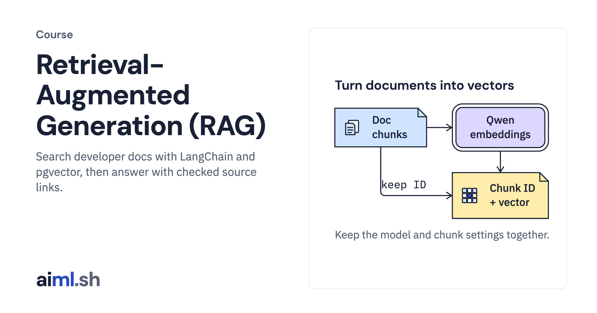

#  Retrieval-Augmented Generation (RAG)

Search developer docs with LangChain and pgvector, then answer with checked source links.

- **Course on aiml.sh:** [https://aiml.sh/courses/rag/](https://aiml.sh/courses/rag/)
- **Lessons:** 6 · **Reading time:** about 2 hours
- **Prerequisites:** Python, JSON, basic SQL tables, embeddings and cosine similarity.

## What you'll learn

- Split and embed documents with LangChain while recording the model and chunk settings.
- Use PGVectorStore to replace, filter and delete indexed chunks.
- Compare exact, HNSW and IVFFlat results with the same saved questions.
- Retrieve source chunks and chart images, then check citation IDs and excerpts.

## Lessons

| # | Lesson | Time | Code | Full lesson |
|---|---|---|---|---|
| 1 | [Build an embedding pipeline with LangChain](01-build-an-embedding-pipeline/) | 22&nbsp;min | [lab](01-build-an-embedding-pipeline/lab/) | [read](https://aiml.sh/courses/rag/build-an-embedding-pipeline/) |
| 2 | [Build a PostgreSQL vector store with LangChain](02-build-a-vector-store/) | 24&nbsp;min | [lab](02-build-a-vector-store/lab/) | [read](https://aiml.sh/courses/rag/build-a-vector-store/) |
| 3 | [Compare exact, HNSW and IVFFlat search in pgvector](03-build-a-vector-search-comparison-exact-ann-pgvector/) | 26&nbsp;min | [lab](03-build-a-vector-search-comparison-exact-ann-pgvector/lab/) | [read](https://aiml.sh/courses/rag/build-a-vector-search-comparison-exact-ann-pgvector/) |
| 4 | [Build a RAG pipeline with citations](04-build-a-rag-pipeline-with-citations/) | 28&nbsp;min | [lab](04-build-a-rag-pipeline-with-citations/lab/) | [read](https://aiml.sh/courses/rag/build-a-rag-pipeline-with-citations/) |
| 5 | [Build multimodal RAG with chart source references](05-build-multimodal-rag-with-verifiable-source-references/) | 26&nbsp;min | [lab](05-build-multimodal-rag-with-verifiable-source-references/lab/) | [read](https://aiml.sh/courses/rag/build-multimodal-rag-with-verifiable-source-references/) |
| 6 | [Rank document vectors with cosine distance](06-build-exact-vector-search/) | 16&nbsp;min | [lab](06-build-exact-vector-search/lab/) | [read](https://aiml.sh/courses/rag/build-exact-vector-search/) |

Each lesson folder has a short summary, its diagram and its lab. The complete lesson, with explanations, recorded results and checks, is on aiml.sh.

[Back to all courses](../../README.md#courses)
